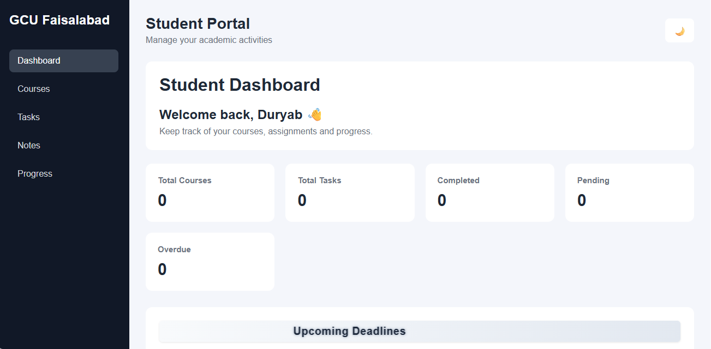

# Student Productivity & Academic Management Dashboard

A responsive web application built to help students manage their courses, tasks, deadlines, and study notes in one place.

The project focuses on making academic task management simple and organized through an interactive dashboard, progress tracking, and persistent browser storage.

## ✨ Features

### 📊 Dashboard
- View the total number of courses and tasks.
- Track completed, pending, and overdue tasks.
- Monitor task completion progress with a progress bar.
- View upcoming deadlines.

### 📚 Course Management
- Add and delete courses.
- Automatically update course statistics.
- Save course data in browser Local Storage.

### 📝 Task Management
- Create, edit, and delete tasks.
- Mark tasks as completed or undo completion.
- Search tasks by title.
- Filter tasks by status or course.
- Sort tasks by nearest or farthest due date.
- Track overdue tasks and upcoming deadlines.

### 📒 Notes Management
- Create, edit, and delete notes.
- Search notes by title or content.
- Sort notes by newest or oldest.
- Save notes automatically in browser Local Storage.

### 🎨 User Interface
- Switch between dark and light themes.
- Remember the selected theme after refreshing.
- Navigate between dashboard sections using the sidebar.
- Highlight the active sidebar link.
- Remember the last opened section.
- Responsive layout for desktop, tablet, and mobile screens.

### 💾 Data Persistence
The application uses browser Local Storage to retain courses, tasks, notes, and selected preferences after a page refresh.

## 🛠️ Technologies Used

- **HTML5** — Application structure
- **CSS3** — Styling, layouts, themes, and responsive design
- **JavaScript (Vanilla JS)** — Application logic and interactivity
- **Local Storage** — Saving data in the browser

## 📂 Project Structure

```text
student-productivity-dashboard/
│
├── index.html
├── README.md
│
├── style.css
│
├── script.js
│
├── assets/
│
└── screenshots/
    ├── dashboard.png
    ├── assignments.png
    └── notes.png
```


## 🚀 Getting Started

You can run this project locally without installing any frameworks or setting up a backend.

1. Clone the repository:

   ```bash
   git clone https://github.com/MuhammadDuryabBakht/student-productivity-dashboard.git
   ```

2. Open the project folder:

   ```bash
   cd student-productivity-dashboard
   ```

3. Open `index.html` in your web browser.

You can also open the project folder in Visual Studio Code and use a local development extension such as Live Server.

## 🖼️ Screenshots

### Dashboard


### Tasks


### Courses


### Notes


## 🎯 Learning Objectives

This project helped me practice and strengthen my understanding of:

- HTML page structure and forms
- CSS styling and responsive layouts
- JavaScript variables, arrays, objects, and functions
- DOM manipulation and event listeners
- Form validation
- Searching, filtering, and sorting data
- Date handling and deadline calculations
- Browser Local Storage
- Building interactive frontend applications

## 🔮 Future Improvements

Possible improvements for a future version include:

- Assignment priority levels
- User authentication and individual accounts
- Backend integration and database storage
- Cloud synchronization across devices

## 👨‍💻 Author

**Muhammad Duryab Bakht**

BS Software Engineering Student  

Government College University Faisalabad (GCUF)

---

⭐ If you like this project, consider giving it a Star!

Thank you for visiting my repository! Feedback and suggestions are always welcome.